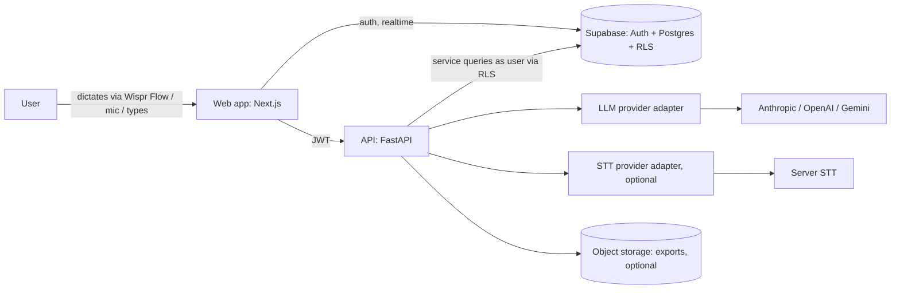
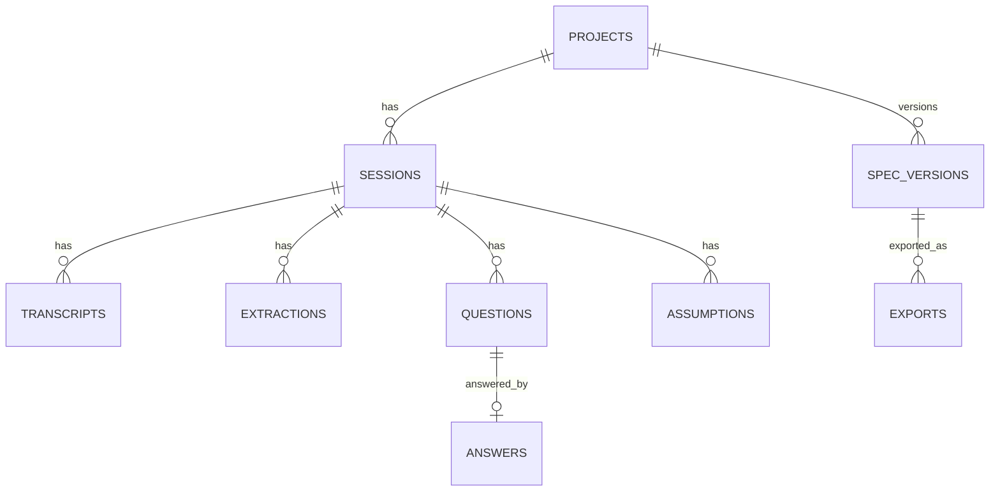

# ARCHITECTURE.md

Status: v1 (planning). Owner: project author. Changes to this file require an ADR in `docs/adr/`.

## 1. Purpose and principles

VoxSpec converts unstructured, noisy speech transcripts into a validated build specification.

Design principles (in priority order):

1. **Final intent wins, and you can see why.** Every decision in a spec traces back to transcript evidence, including what was superseded.
2. **LLM extracts, code decides.** Language models produce structured claims. Deterministic code resolves conflicts, scores readiness, and validates shape. This makes the core testable and evaluable.
3. **Assumptions are visible, never silent.** Anything the user did not say is labelled as an assumption with a risk level.
4. **Strict output contract.** The spec is JSON validated against a schema, then rendered to Markdown. Markdown is never the source of truth.
5. **Provider-agnostic.** LLM and STT sit behind interfaces. A `fake` provider makes the whole pipeline testable offline.
6. **Boring, observable, secure.** Simple deployables, structured logs, RLS on every table, no secrets in the client.

## 2. System context



Wispr Flow is a system-level dictation tool: it types into any focused text field. VoxSpec therefore treats its text box as a first-class voice surface and does not need to capture audio itself. Browser speech recognition and server STT are optional extras behind `STTProvider`.

## 3. Components

### 3.1 Web (`apps/web`)
- Next.js App Router, TypeScript strict, Tailwind, Radix primitives.
- Server components for reading, client components for the dictation workspace and streaming.
- Supabase JS only for auth session; all business operations go through the API.
- Streams pipeline stage events via Server-Sent Events.

### 3.2 API (`apps/api`)
- FastAPI, Pydantic v2, async. Versioned under `/v1`.
- Verifies the Supabase JWT, then queries Postgres **with the user's JWT context** so RLS is the authorization backstop (see `docs/SECURITY.md`).
- Layers: `api` (routers) -> `services` (use cases) -> `pipeline` (pure domain logic) -> `repos` (DB) and `llm` / `stt` (adapters).
- No business logic in routers. No DB access in `pipeline`.

### 3.3 Database (`supabase/`)
- Postgres with RLS on every table. Owner-scoped policies. Migrations are SQL files, applied in order.

## 4. The pipeline

```
raw transcript
   |  1 normalize
   v
clean utterances (+ offsets to raw)
   |  2 extract claims            (LLM, structured)
   v
claims [{topic, value, stance, span, lang}]
   |  3 resolve (converge)        (deterministic)
   v
final intent + revision trace
   |  4 gap analysis              (LLM, structured + deterministic ranking)
   v
assumptions[] + questions[<=3]
   |  5 compile                   (LLM, structured, schema-validated)
   v
spec JSON
   |  6 score + render            (deterministic)
   v
readiness + SPEC.md + bundle
```

### Stage contracts

| # | Stage | Type | Input | Output | Failure mode |
|---|---|---|---|---|---|
| 1 | normalize | deterministic | raw text (<= 12,000 chars) | `Utterance[]` with char offsets, language tags (`en`, `hi`, `hi-Latn`, `mixed`) | never fails; empty input rejected earlier with 422 |
| 2 | extract | LLM | `Utterance[]` | `Claim[]` | schema violation -> one repair retry -> `PIPELINE_EXTRACT_FAILED` |
| 3 | resolve | code | `Claim[]` | `Decision[]`, `RevisionTrace[]` | pure function, total |
| 4 | gaps | LLM + code | decisions | `Assumption[]`, `Question[]` (max 3, ranked by impact) | falls back to rule-based gaps from the required-field checklist |
| 5 | compile | LLM | decisions, answers, assumptions | `Spec` JSON | schema violation -> repair retry -> fail with partial result saved |
| 6 | score+render | code | `Spec` | readiness 0-100 + breakdown, Markdown, bundle | pure |

**Claim** (stage 2 output):
```json
{ "id": "c7", "topic": "booking.approval", "value": "owner approves via WhatsApp",
  "stance": "assert | revise | retract | tentative",
  "revises": "c3 | null", "span": {"start": 412, "end": 468}, "lang": "hi-Latn" }
```

**Resolution rules (stage 3)** are documented in `docs/EVAL.md` and implemented as a pure function with property tests:
- Claims group by `topic`. Within a topic, order by transcript position.
- `revise` or `retract` supersedes the claim named in `revises`, or the most recent open claim in the topic if omitted.
- `tentative` never supersedes an `assert`; it becomes an assumption candidate instead.
- Final value is the last non-superseded `assert`/`revise`. A topic whose last stance is `retract` is dropped and logged in the trace.
- Every decision keeps `evidence[]` spans and `superseded[]` values, which power the UI's "what changed your mind" view.

### Provider adapters

```python
class LLMProvider(Protocol):
    async def structured(self, *, system: str, user: str, schema: type[BaseModel],
                         temperature: float = 0.0, timeout_s: float = 30) -> BaseModel: ...

class STTProvider(Protocol):
    async def transcribe(self, audio: bytes, mime: str, lang_hint: str | None) -> str: ...
```

Implementations: `anthropic`, `openai`, `gemini`, `fake` (deterministic fixtures keyed by input hash, used by CI and Playwright). Provider chosen by `LLM_PROVIDER` env var. Prompts are versioned files in `apps/api/app/pipeline/prompts/` and the version is stored with each extraction.

## 5. Data model (summary)

Authoritative DDL: `supabase/migrations/0001_init.sql`.



Every table carries `owner_id uuid default auth.uid()` and an owner RLS policy. Spec versions are immutable once written.

## 6. API surface (v1)

Full contract in `docs/SPEC_SCHEMA.md`.

| Method | Path | Purpose |
|---|---|---|
| POST | `/v1/projects` | create project |
| GET | `/v1/projects` | list projects |
| POST | `/v1/projects/{id}/sessions` | start a session |
| POST | `/v1/sessions/{id}/transcripts` | submit transcript |
| POST | `/v1/sessions/{id}/analyze` (SSE) | run stages 1-4 |
| POST | `/v1/sessions/{id}/answers` | answer up to 3 questions |
| POST | `/v1/sessions/{id}/compile` (SSE) | run stages 5-6, creates spec version |
| GET | `/v1/projects/{id}/specs` | list versions |
| GET | `/v1/specs/{id}` | spec JSON + markdown + readiness |
| GET | `/v1/specs/{a}/diff/{b}` | structural diff between versions |
| GET | `/v1/specs/{id}/export?format=md\|zip&agent=antigravity\|claude-code\|cursor` | export bundle |
| GET | `/healthz`, `/readyz` | liveness, readiness |

Errors use RFC 7807 problem+json with a stable `code` field.

## 7. Repository layout

```
voxspec/
  apps/
    web/                      Next.js app
      app/(marketing)/        landing
      app/(app)/projects/     workspace, sessions, specs
      components/             ui, dictation, trace, spec-viewer
      lib/                    api client, supabase, sse
      tests/e2e/              Playwright
    api/
      app/
        main.py
        core/                 config, auth, logging, errors
        api/v1/               routers
        services/             use cases
        pipeline/             normalize, extract, resolve, gaps, compile, score, render, prompts/
        llm/                  base, anthropic, openai, gemini, fake
        stt/                  base, browser-none, server
        repos/                db access
        schemas/              Pydantic models (source of truth for Spec)
      tests/                  unit, property, integration
  packages/spec-schema/       JSON Schema + generated TS types
  evals/                      golden transcripts, runner, reports
  supabase/migrations/
  docs/  prompts/  .agents/skills/
```

## 8. Cross-cutting concerns

- **Config:** `pydantic-settings`, all via env, validated at boot, fail fast.
- **Logging:** structured JSON, request id on every line, never log transcript bodies at INFO (they are user content). DEBUG only, off in prod.
- **Observability:** per-stage latency and token counts stored on `extractions`; `/metrics` Prometheus endpoint optional.
- **Rate limiting:** per-user token bucket on analyze/compile (they cost money).
- **Idempotency:** `compile` accepts an `Idempotency-Key` header to avoid duplicate versions on retry.
- **Limits:** transcript <= 12,000 chars, <= 3 questions per round, <= 2 clarification rounds.
- **Accessibility:** WCAG 2.2 AA, full keyboard use, reduced-motion respected.

## 9. Deployment

- Local: `supabase start` + `docker compose up`.
- Prod: web on Vercel, API as a container (Fly.io / Render / Cloud Run), Supabase managed. All three are interchangeable behind env vars.
- CI (GitHub Actions): lint, typecheck, unit, integration against ephemeral Postgres, Playwright against `fake` LLM, eval smoke run, container build, dependency and secret scan.

## 10. Performance budgets

| Operation | p50 | p95 |
|---|---|---|
| analyze (stages 1-4) | 6 s | 12 s |
| compile (stages 5-6) | 8 s | 15 s |
| page TTI (web) | 1.5 s | 3 s |
| resolve (stage 3) | < 5 ms | < 20 ms |

## 11. Known risks

| Risk | Mitigation |
|---|---|
| LLM drifts from schema | Pydantic validation, repair retry, golden-set evals gate merges |
| Hinglish revision markers under-detected | marker lexicon in `docs/EVAL.md`, benchmark tracks per-language accuracy |
| Prompt injection via transcript | transcript is data; delimiters, no tool access in pipeline, output validated, see `docs/SECURITY.md` |
| Cost runaway | rate limits, length caps, per-user daily budget |

## 12. Decisions

See `docs/adr/`: 0001 stack, 0002 provider abstraction, 0003 intent convergence pipeline.
