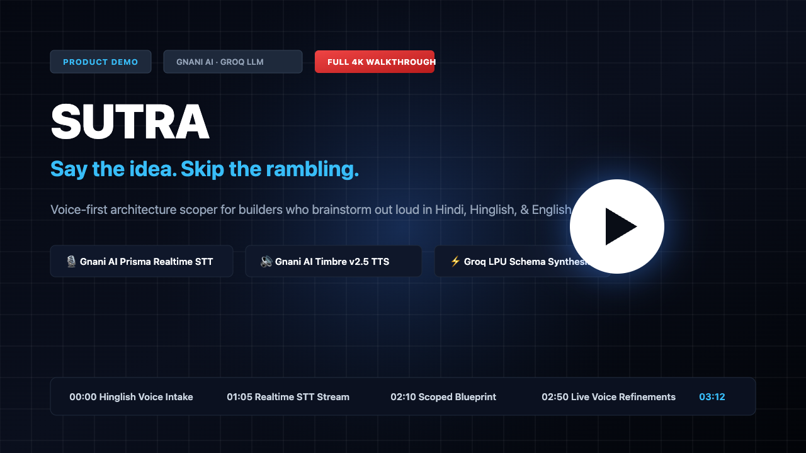
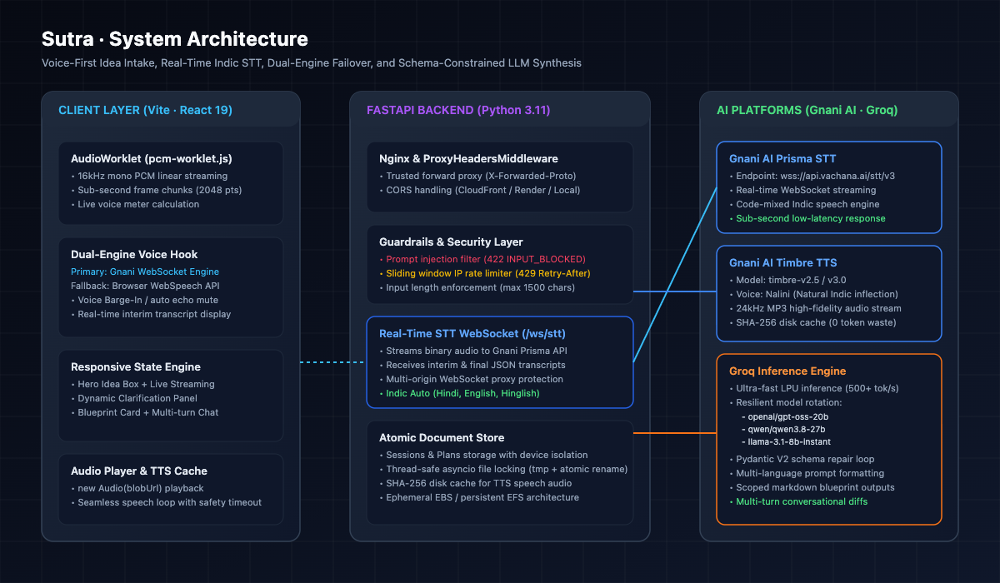
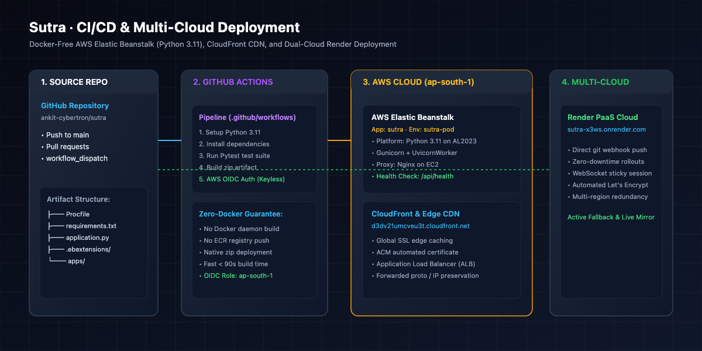

<div align="center">
  

  <br />
  <br />

  <p><strong>Say the idea. Skip the rambling.</strong><br />
  A voice-first product architecture engine built for builders who brainstorm out loud in <strong>Hindi, Hinglish, and English</strong>.<br />
  Powered by <strong>Gnani AI</strong> (Prisma Real-Time STT + Timbre Neural TTS) and <strong>Groq</strong> (High-Throughput Inference).</p>
</div>

[](https://d3dv21umcveu3t.cloudfront.net/#p=pln_e6185ff862)
[](https://sutra-x3ws.onrender.com/#top)
[](https://github.com/ankit-cybertron/sutra/actions)
[](https://www.python.org/)
[](https://fastapi.tiangolo.com/)

---

## Live Deployments & Product Walkthrough

| Environment | Endpoint / URL | Description |
|---|---|---|
| **Production CloudFront** | [d3dv21umcveu3t.cloudfront.net/#p=pln_e6185ff862](https://d3dv21umcveu3t.cloudfront.net/#p=pln_e6185ff862) | Global edge distribution backed by AWS ALB + Elastic Beanstalk |
| **Multi-Cloud Mirror** | [sutra-x3ws.onrender.com/#top](https://sutra-x3ws.onrender.com/#top) | Active secondary cloud deployment with automated GitOps |
| **Backend Health Check** | [/api/health](https://sutra-x3ws.onrender.com/api/health) | Live system status, provider connections, and model health |
| **Interactive API Docs** | [/docs](https://sutra-x3ws.onrender.com/docs) | OpenAPI 3.1 Swagger UI documentation |

### Video Walkthrough (YouTube Demo)

[](https://www.youtube.com/watch?v=placeholder)

> 🎥 **[Watch the 3-Minute Walkthrough on YouTube](https://www.youtube.com/watch?v=placeholder)**  
> Experience end-to-end idea intake in Hinglish, sub-second transcription with Gnani AI, automated blueprint generation, and voice-driven plan modifications.

---

## System Architecture



Sutra is engineered as a zero-latency, voice-first system composed of three core tiers:

1. **Client Tier (`apps/web`):** Built with React 19, TypeScript, and Vite. Utilizes a low-latency Web Audio `AudioWorklet` (`pcm-worklet.js`) running in a dedicated audio thread to capture, downsample, and stream 16kHz linear PCM frames directly over WebSockets.
2. **Backend Application Tier (`apps/api`):** Async FastAPI service running on Python 3.11 with Gunicorn and Uvicorn workers. Handles reverse-proxy header preservation (`ProxyHeadersMiddleware`), prompt injection guardrails, IP sliding-window rate limiters, WebSocket relay, and atomic persistence.
3. **AI Intelligence Tier:**
   - **Gnani AI:** Prisma STT for sub-second streaming Indic transcription and Timbre v2.5 / v3.0 for natural neural voice synthesis.
   - **Groq:** High-throughput LPU inference running Pydantic V2 schema-constrained models (`openai/gpt-oss-20b`, `qwen/qwen3.8-27b`, `llama-3.1-8b-instant`).

---

## Gnani AI Deep Dive: Integrations & Features

Sutra extensively integrates **Gnani AI** across the voice pipeline to provide an authentic, natural Indic conversational experience:

```
                  ┌────────────────────────────────────────┐
                  │          Browser Microphone            │
                  └───────────────────┬────────────────────┘
                                      │ 16kHz PCM Frames
                                      ▼
                  ┌────────────────────────────────────────┐
                  │    Sutra WebSocket Relay (/ws/stt)     │
                  └───────────────────┬────────────────────┘
                                      │ WSS Passthrough
                                      ▼
                  ┌────────────────────────────────────────┐
                  │       Gnani AI Prisma Engine           │
                  │   (wss://api.vachana.ai/stt/v3)        │
                  └───────────────────┬────────────────────┘
                                      │ Interim & Final Tokens
                                      ▼
┌──────────────────┐    Text Prompt   ┌──────────────────┐    TTS Request   ┌──────────────────┐
│  Live UI Display │ ◄─────────────── │   FastAPI Core   │ ───────────────► │ Gnani AI Timbre  │
└──────────────────┘                  └──────────────────┘                  │ (/api/v1/tts/..) │
                                                                            └─────────┬────────┘
                                                                                      │ MP3 Stream
                                                                                      ▼
                                                                            ┌──────────────────┐
                                                                            │  SHA-256 Caching │
                                                                            └──────────────────┘
```

### 1. Real-Time Streaming Speech-to-Text (Prisma STT)
- **WebSocket Protocol:** Streamed directly through `/ws/stt` into Gnani AI’s `wss://api.vachana.ai/stt/v3` engine.
- **Audio Specification:** Raw Linear PCM 16-bit mono sampled at 16,000 Hz, delivered in 2,048-sample chunks to eliminate buffering delay.
- **Sub-Second Interim Transcripts:** Transcripts stream back to the UI in real time, giving builders instant visual feedback as they speak.
- **REST Fallback (`/api/stt`):** Secondary endpoint accepting multipart audio uploads (`audio/wav`) for clients in constrained network environments.

### 2. Code-Mixed Indic Language Recognition
- **Mixed-Language Support:** Configured with `indic-auto` and `mixed` language codes, enabling builders to speak freely in **English**, **Hindi (Devanagari)**, or conversational **Hinglish** (e.g., *"Ek inventory tracking app banana hai local dukaan ke liye"*).
- **Phonetic Script Preservation:** Transcribed words retain contextual phrasing without robotic word-by-word translation.

### 3. Neural Voice Synthesis (Timbre TTS)
- **Model Versions:** Powered by Gnani AI's `timbre-v2.5` and `timbre-v3.0` neural speech engines via `/api/v1/tts/inference`.
- **Bilingual Persona (`Nalini`):** Configured with custom voices tailored for natural cadence and inflection in both Hindi and Indian English.
- **Prompt Credit Discipline & SHA-256 Caching:**
  - Every synthesis request is hashed via SHA-256 (`text:voice:lang`).
  - Cached MP3 payloads are written to local disk cache (`data/tts_cache`), achieving **100% deduplication** for repeated prompts and zero redundant API credit consumption.
  - Text prompts are capped at 300 characters to keep voice summaries punchy and fast.

### 4. Voice Barge-In & Acoustic Echo Cancellation
- Hardware echo cancellation (`echoCancellation: true`, `noiseSuppression: true`) coupled with client-side speech loop coordination.
- When the user starts speaking while audio is playing, playback cuts off instantly, allowing continuous hands-free dialogue.

### 5. Resilient Dual-Engine Failover
- If microphone access or remote WebSocket connections encounter network partitions, the client automatically falls back to browser-native `SpeechRecognition` and `SpeechSynthesis`, guaranteeing zero voice interruption.

---

## Groq LLM: Structured Engineering Blueprints

```
Raw Idea / Voice Transcript
           │
           ▼
┌──────────────────────────────────────────────┐
│       Prompt Injection Guardrail Layer       │ ──► Rejected? (RFC 7807 422 INPUT_BLOCKED)
└──────────────────────┬───────────────────────┘
                       │ Validated Input
                       ▼
┌──────────────────────────────────────────────┐
│         Groq LPU Inference Engine            │
│  (openai/gpt-oss-20b · qwen/qwen3.8-27b)     │
└──────────────────────┬───────────────────────┘
                       │ JSON Mode Output
                       ▼
┌──────────────────────────────────────────────┐
│     Pydantic V2 Schema Validation & Normalizer│
│  (Auto-repair, Step numbering, Impact enum)  │
└──────────────────────┬───────────────────────┘
                       │ Validated PlanDoc
                       ▼
          Structured Markdown Blueprint
```

### 1. Resilient Model Architecture
Groq models are dynamically evaluated with automatic failover to handle provider availability:
- **Primary:** `openai/gpt-oss-20b` (fast structured output)
- **Secondary:** `qwen/qwen3.8-27b`
- **Fallback:** `llama-3.1-8b-instant`, `llama-3.3-70b-versatile`

### 2. Pydantic V2 Schema Guarantee
All LLM outputs conform to strictly typed contracts matching the frontend TypeScript interfaces:
- **`MustHave` List:** Capped at 5 critical items with explicit acceptance criteria to protect MVP scope.
- **`BuildStep` Sequence:** Numbered implementation steps with title and architectural detail.
- **`FirstPrompt` Generator:** Standalone, copyable prompt tailored for coding agents (Claude Code, Cursor, Codex).
- **Multi-Turn Plan Mutations:** Refinements like *"Add dark mode"* or *"Switch database to PostgreSQL"* produce an updated `PlanDoc` (v2, v3) along with concise change summaries.

---

## Deployment Architecture



### AWS Elastic Beanstalk (Python 3.11 · Native Platform)
- **Zero-Docker Pipeline:** Eliminates Docker daemon and container registry overhead. Code is packaged directly into a native zip artifact and deployed to Amazon Linux 2023.
- **Process Manager (`Procfile`):**
  ```bash
  web: gunicorn -w 2 -k uvicorn.workers.UvicornWorker --bind 0.0.0.0:5000 application:app
  ```
- **Nginx Reverse Proxy:** `.ebextensions/01_fastapi.config` configures Elastic Beanstalk’s Nginx proxy to forward requests and WebSocket upgrades to port 5000.
- **HTTPS & Trusted Proxies:** `ProxyHeadersMiddleware` preserves `X-Forwarded-Proto` and `X-Forwarded-For` from AWS Application Load Balancers (ALB) and ACM certificates.
- **GitHub Actions OIDC:** Keyless authentication assumes an AWS IAM role in `ap-south-1` without storing static AWS access keys in repository secrets.

### Data Persistence Architecture
- **Elastic Beanstalk Ephemeral Storage:** EC2 instances in an Auto Scaling group utilize ephemeral root storage. Instance replacements recreate local files in `./data`.
- **Production Recommendation:** For enterprise multi-instance deployments, mount an **Amazon EFS** (Elastic File System) volume at `/var/app/current/data` or configure an S3/DynamoDB storage adapter.

---

## Repository Structure

```
├── .ebextensions/
│   └── 01_fastapi.config      # AWS Elastic Beanstalk Nginx & port configuration
├── .github/
│   └── workflows/
│       └── deploy.yml         # GitHub Actions OIDC deploy to Elastic Beanstalk
├── apps/
│   ├── api/                   # FastAPI backend service
│   │   ├── app/
│   │   │   ├── adapters/      # Gnani AI (Prisma STT + Timbre TTS) & Groq LLM
│   │   │   ├── prompts/       # Structured prompt templates (clarify, plan, chat)
│   │   │   ├── routers/       # REST endpoints & WebSocket relay
│   │   │   ├── services/      # Session, Plan, Voice, and Usage logic
│   │   │   ├── store/         # Thread-safe atomic JSON document storage
│   │   │   ├── config.py      # Environment variables & provider settings
│   │   │   ├── guardrails.py  # Prompt injection & input validation
│   │   │   └── schemas.py     # Pydantic V2 models matching TypeScript contract
│   │   └── tests/             # Pytest test suite (contract, adapters, security)
│   └── web/                   # React 19 frontend application
│       ├── public/            # Static assets & AudioWorklet processor
│       ├── src/
│       │   ├── api/           # RFC 7807 HTTP client & typed contracts
│       │   ├── components/    # Hero, ClarifyPanel, PlanCard, ChatPanel, Nav
│       │   ├── voice/         # AudioWorklet, Gnani STT, WebSpeech engines
│       │   └── styles/        # Responsive, minimalist dark aesthetic
│       └── tests/             # Playwright browser integration tests
├── docs/
│   ├── assets/                # Architecture, deployment, and preview diagrams
│   ├── DECISIONS.md           # Architectural decision records (ADRs)
│   ├── INTEGRATION_NOTES.md   # API contract verification notes
│   ├── SUBMISSION.md          # Gnani Challenge submission summary
│   └── VOICE.md               # Audio streaming & worklet protocol guide
├── scripts/
│   ├── smoke.sh               # Automated end-to-end smoke test script
│   └── generate_diagrams.js   # Automated architecture asset generator
├── application.py             # Elastic Beanstalk application entry point
├── Procfile                   # Process manager command for AWS EB
├── requirements.txt           # Production Python dependencies
└── README.md
```

---

## Local Development & Setup

### 1. Prerequisites
- **Python 3.11+**
- **Node.js 20+**
- Active API keys for **Groq** and **Gnani AI**

### 2. Environment Configuration
Create a `.env` file in the root directory:

```ini
# API & Storage
API_ENV=development
API_PORT=8000
API_CORS_ORIGINS=http://localhost:3000,http://localhost:5173,http://localhost:8000

# Groq LLM
GROQ_API_KEY=gsk_your_groq_api_key_here
GROQ_MODEL=openai/gpt-oss-20b
GROQ_FALLBACK_MODEL=qwen/qwen3.8-27b
GROQ_TIMEOUT_S=25.0

# Gnani AI (Indic Voice)
GNANI_API_KEY=your_gnani_api_key_here
GNANI_BASE_URL=https://api.vachana.ai
GNANI_LANGUAGE_CODE=indic-auto
GNANI_TTS_VOICE_HI=Nalini
GNANI_TTS_VOICE_EN=Nalini
GNANI_MODE=live
```

### 3. Run Backend API Server
```bash
# Setup virtual environment
python3 -m venv apps/api/.venv
source apps/api/.venv/bin/activate
pip install -r requirements.txt

# Run development server
PYTHONPATH=. uvicorn application:app --host 0.0.0.0 --port 8000 --reload
```

### 4. Run Frontend Client
```bash
cd apps/web
npm install
npm run dev
```

Visit `http://localhost:5173` to test the full voice and plan generation flow locally.

---

## Testing & Quality Assurance

### Automated Backend Tests (Pytest)
Runs contract validation, prompt injection guardrail tests, Gnani TTS SHA-256 caching checks, and atomic store concurrency:
```bash
PYTHONPATH=. apps/api/.venv/bin/pytest apps/api/tests/ -v
```

### End-to-End Smoke Test Suite
Executes live HTTP and WebSocket checks against a running server:
```bash
./scripts/smoke.sh
```

### Frontend Typecheck & Build
```bash
npm --prefix apps/web run build
```

---

## API Contract Summary

All errors strictly follow **RFC 7807 (`application/problem+json`)**:

| Endpoint | Method | Input | Success Output | Error Codes |
|---|---|---|---|---|
| `/api/health` | `GET` | — | `HealthResponse` | — |
| `/api/sessions` | `POST` | `{idea, lang, source}` | `CreateSessionResult` | `422 INPUT_BLOCKED`, `413 INPUT_TOO_LONG`, `429 RATE_LIMITED` |
| `/api/sessions/{id}/plan` | `POST` | `{answers: []}` | `PlanDoc` (v1) | `404 NOT_FOUND`, `429 RATE_LIMITED`, `502 PROVIDER_UNAVAILABLE` |
| `/api/plans/{id}` | `GET` | — | `PlanDoc` | `404 NOT_FOUND` |
| `/api/plans/{id}/chat` | `POST` | `{message, source, lang}` | `ChatResult` (v2+) | `422 INPUT_BLOCKED`, `404 NOT_FOUND`, `429 RATE_LIMITED` |
| `/api/tts` | `POST` | `{text, lang}` | `audio/mpeg` (binary) | `422 INPUT_BLOCKED`, `503 VOICE_UNAVAILABLE` |
| `/ws/stt` | `WS` | Binary 16kHz PCM | JSON `{transcript, is_final}` | `1008 POLICY_VIOLATION`, `1011 INTERNAL_ERROR` |
| `/api/usage` | `GET` | — | `UsageResponse` | — |

---

## License

Crafted for the **Gnani Great Indian AI Internship Challenge**.  
Licensed under the [MIT License](LICENSE).
