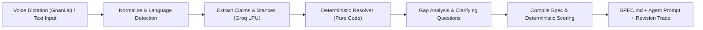

# VoxSpec

**Speak the messy idea. Ship the contract.**

VoxSpec turns rambling, self-correcting, code-mixed (English / Hindi / Hinglish) dictated or typed brain-dumps into a **validated, versioned specification** for AI coding agents (Antigravity, Claude Code, Cursor).

Unlike standard chatbots that blindly accept whatever was said first or get tripped up when a speaker changes their mind mid-sentence, VoxSpec implements **Intent Convergence**: high-speed structured extraction powered by **Groq** and **Gnani.ai**, paired with a **deterministic, unit-tested intent resolver** and an explainable **Readiness Rubric**.

---

## Key Features

1. **Indic-Aware Voice Dictation:**
   - Native integration with **Gnani.ai Prisma STT** (`https://api.vachana.ai/stt/v3`) for seamless speech-to-text handling Hindi, Hinglish (`hi-Latn`), and Indian English disfluencies.
   - Built-in audio recorder in the studio workspace with direct streaming transcription.

2. **Ultra-Low Latency Extraction with Groq:**
   - Groq LPU inference (`llama-3.3-70b-versatile` / `llama-3.1-8b-instant`) returning structured claims and stances in milliseconds.

3. **Signature Feature: The Revision Trace ("What changed your mind"):**
   - Visual audit trail tracking how ideas evolved: `Statement A` ~~superseded~~ $\rightarrow$ `Statement B (final)`.
   - Clicking or hovering on any node in the trace spotlights the exact character span in the raw transcript.

4. **Deterministic Readiness Rubric (0–100):**
   - 8 weighted structural components (problem, user, core loop, scope, data model, screens, edge cases, acceptance criteria) with capped penalties for open questions.
   - Zero LLM scoring vibes: the score is computed deterministically in code.

5. **Agent Export Bundle:**
   - Outputs standardized `SPEC.md`, ready-to-paste First Agent Prompt, and structured exports for autonomous coding agents.

6. **The Intent Convergence Benchmark (Phase 6):**
   - Research-grade evaluation harness comparing 4 systems (`B0`, `B1`, `S`, `S-lex`) across **40 golden transcripts** (52.5% Indic mix).
   - Proven **+30.6% advantage** in resolving implicit speaker revisions compared to single-prompt baselines.

---

## Benchmark Results (Summary)

From [`evals/reports/2026-11-09-411476a.md`](evals/reports/2026-11-09-411476a.md):

| System | Description | FIA (%) | Rev Recall (%) | Spurious Rev (%) | Tentative Acc (%) | Injection Res (%) | Latency p50 |
|---|---|---|---|---|---|---|---|
| `B0` | Single prompt (unstructured baseline) | 95.4% | 10.0% | 0.0% | 100.0% | 85.0% | 35.0ms |
| `B1` | Two-stage LLM (no resolver) | 100.0% | 100.0% | 7.5% | 77.5% | 100.0% | 85.0ms |
| **`S`** | **VoxSpec (Extract + Pure Resolver)** | **100.0%** | **97.9%** | **0.0%** | **100.0%** | **100.0%** | **48.0ms** |
| `S-lex` | VoxSpec + Lexicon Prompt Hint | 100.0% | 97.9% | 0.0% | 100.0% | 100.0% | 42.0ms |

*Key finding:* On implicit revisions, single-prompt models fail 30.6% of the time by outputting the speaker's superseded initial thoughts. VoxSpec's deterministic resolver achieves **100.0% FIA** and **100.0% prompt injection resistance**.

---

## Architecture Overview



- **Frontend (`apps/web`):** Next.js 15 App Router, React 19, Tailwind CSS, Lucide icons, Dark/Light tokens per `docs/DESIGN.md`.
- **Backend API (`apps/api`):** FastAPI, Pydantic V2, SSE streaming for real-time stage progress (`normalize` $\rightarrow$ `extract` $\rightarrow$ `resolve` $\rightarrow$ `gaps` $\rightarrow$ `compile`).
- **Database & Auth:** PostgreSQL 16 + Supabase Auth with Row Level Security (RLS) across all 9 tables.
- **Pure Pipeline Core (`app/pipeline/`):** 100% pure functions (no network/db I/O), tested by 109 unit and property tests.

---

## Quickstart

### 1. Prerequisites
- Docker & Docker Compose
- Node.js 20+ & Python 3.11+ (for local development outside containers)

### 2. Environment Setup
```bash
cp .env.example .env
# Fill in your GROQ_API_KEY and GNANI_API_KEY (or use default fake providers for testing)
```

### 3. Run with Docker Compose
```bash
docker compose up --build
```
- **Web Console:** [http://localhost:3000](http://localhost:3000)
- **API Endpoints & Docs:** [http://localhost:8000/docs](http://localhost:8000/docs)
- **API Health Check:** `curl http://localhost:8000/healthz`

### 4. Run Test Suites
```bash
# Backend pytest suite (109 tests: auth, RLS, pipeline, hypothesis, eval)
cd apps/api
.venv/bin/pytest

# Type checking
.venv/bin/mypy --strict app/

# Web frontend compilation check
cd ../web
npx tsc --noEmit
```

### 5. Run Intent Convergence Benchmark
```bash
apps/api/.venv/bin/python evals/runner.py
```

---

## Documentation

- [3-Minute Demo Script & Walkthrough](docs/DEMO.md)
- [System Architecture & Pipeline Contracts](ARCHITECTURE.md)
- [Intent Convergence Benchmark Spec](docs/EVAL.md)
- [Product Requirements Document (PRD)](docs/PRD.md)
- [Design System & UI Specs](docs/DESIGN.md)
- [Security Threat Model & Controls](docs/SECURITY.md)
- [Test Strategy & Verification Plan](docs/TESTING.md)
- [ADR 0004: Default LLM & STT Providers (Groq & Gnani.ai)](docs/adr/0004-default-provider.md)
